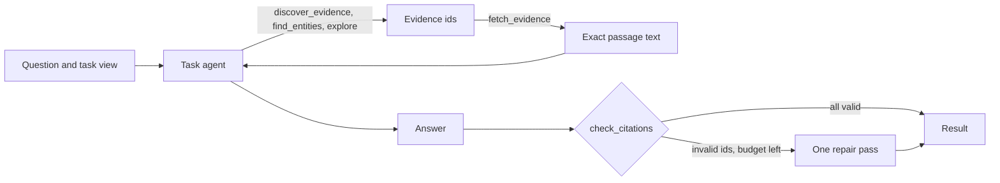

# Agent loop

The agent loop turns one question into a cited answer. A single agent works on a named task. It discovers evidence in the graph, fetches the exact text it needs, and writes an answer that cites only the evidence it fetched. A citation check runs after the answer, and one repair pass removes or replaces citations that do not check out.

## Why it exists

One search can miss part of a multi-part question. "Who worked with Charles Babbage, and where?" needs two facts that may sit in different passages. The agent runs several evidence calls for one task, and it keeps the task state between calls.

The agent can also resume a task. Each task has a name. A run with the same task name reloads the evidence fetched earlier and the events recorded for that task.

Citations make claims traceable. They do not make the source correct.

## How it works

1. The run creates or resumes the task and builds its task view. The view is data, and the agent reads it before it acts.
2. The agent calls evidence tools. `discover_evidence` returns evidence ids for passages in scope. `find_entities` and `explore` search the graph. `navigate` moves from one passage to related text.
3. The agent calls `fetch_evidence` on the ids it wants to cite. Only a fetch that returns complete text makes an id citable.
4. The agent writes the answer and cites ids in square brackets.
5. The run checks every cited id against the ids that were fetched in scope. If some are invalid and the tool budget has room, one repair pass asks the agent to remove or fetch them.
6. The run returns the answer, a status, the valid citations, and any invalid ids.

The agent can also record progress with `set_step` and record decisions with `record_decision`. It reads earlier decisions with `search_decisions`. A decision counts only when its write tool confirms that the record was saved.

## Result status

| Status | Meaning |
|---|---|
| `answered` | The answer has no invalid citations and no limit was hit. |
| `insufficient_evidence` | The answer says that the evidence is insufficient. |
| `partial` | Some cited ids failed the citation check after the repair pass. |
| `partial_retrieval` | A retrieval call failed during the run. |
| `budget_exhausted` | The run hit the step limit or the tool-call limit. |
| `recording_failed` | A task event or decision could not be recorded. |

## Citation ids

Evidence ids start with `ev1:`. A span id names a range of a chunk, and a chunk id names a whole chunk. The agent copies these ids from discovery results. It does not make them up.

## Limits

These settings bound one run. Set them with `AGENT_` variables or `AgentSettings`.

| Setting | Default | Effect |
|---|---|---|
| `recursion_limit` | `50` | The maximum LangGraph steps. A run that reaches it returns `budget_exhausted`. |
| `max_tool_calls` | `20` | The maximum tool calls in one task run. |
| `max_result_characters` | `12000` | The maximum text that one evidence fetch returns. |

The result has two parts that matter most. `answer` holds Markdown with readable source references in place of validated inline evidence IDs. `citations` lists the actual fetched evidence, including canonical IDs, stored titles, source URIs, and locations. A citation to a narrower span retains its fetched parent in that list. Invalid citation groups remain visible and keep the run's `partial` status.

An HTTP(S) source can appear as `[Annual report, pages 12](https://example.org/report.pdf)`. Local files and inline documents appear as non-link references, such as `(Annual report, pages 12)`. No URL is inferred from an evidence ID or document key. Source URLs open the stored source address, not necessarily the exact passage or historical version. Superseded evidence is labeled in the reference.

The agent validates canonical IDs before formatting the answer. Do not pass the formatted `answer` back to `check_citations` to recover provenance. Use the returned `citations` records instead. Existing Markdown links are left unchanged; the automatic formatter handles canonical IDs in plain square brackets, including comma- or semicolon-separated groups.

## Citations in MCP clients

`fetch_evidence` returns the same source metadata and a `citation_markdown` field in both its structured result and serialized text. The field is `null` unless the evidence was fetched completely. MCP clients should keep `evidence_id` for `check_citations`, then place the readable reference beside the supported claim. The server instructs the client to use those references, but the client controls its final answer and link rendering.

These are ordinary Markdown links, not native citation chips. The [MCP tools specification](https://modelcontextprotocol.io/specification/2025-11-25/server/tools) defines result content, not citation presentation. [Claude Code's MCP support](https://code.claude.com/docs/en/mcp) does not promise native citations for arbitrary tool results. [Gemini grounding](https://ai.google.dev/gemini-api/docs/google-search) and [OpenAI web search](https://platform.openai.com/docs/guides/tools-web-search) use provider-specific citation metadata. This server does not emit those annotations or implement OpenAI's separate Company Knowledge search/fetch contract.

:::note
The agent needs the `agents` extra. `build_agent` raises `AgentMissingExtraError` when the extra is not installed.
:::

Design choices

The agent has no subagents. The general-purpose subagent is disabled in the harness profile, so every evidence call runs in the one agent.

The agent judges only the evidence it fetched. The citation check, not the model, decides whether a cited id is valid. A fetch outside the trusted scope fails, so the agent cannot cite text the caller did not allow.

Source passages, task events, and tool results are data. The system prompt tells the agent not to follow instructions found in them.

## Related

- Guide: [Retrieve and answer](../guides/retrieve-and-answer.mdx)
- Guide: [Trace an agent run](../guides/trace-an-agent-run.mdx)
- Concepts: [Retrieval](./retrieval.mdx), [Observability](./observability.mdx)
- Reference: [Agents API](../api/agents/index.md), [Configuration](../reference/configuration.mdx)
- Reference: [Candidates](../reference/candidates.mdx)
