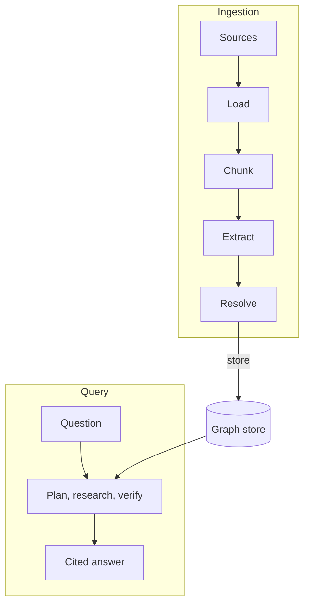

# Architecture

Agentic GraphRAG has two connected flows: ingestion builds a graph from source documents, and retrieval uses that graph to find evidence for questions. The graph keeps links between facts and their source text, so an answer can use both structure and passages.

## Why it exists

A vector search finds passages that resemble a question, but it does not connect facts across passages. A graph adds those links while retaining the source text needed to support an answer.

Agentic GraphRAG stores the facts as a graph and keeps the source text next to them. A question can use both: the passage that states a fact, and the entities that connect passages.

The components separate source parsing, graph construction, and search. You can replace storage or embedding components through their interfaces, but the graph queries still depend on Neo4j and Cypher today. The [Graph storage](./graph-storage.mdx) page explains that boundary.

## How it works

*The ingestion flow writes to the graph store. The query flow reads from it. The Agent loop page shows the plan, research and verify steps in detail.*

Ingestion loads each source as a document, chunks its text, extracts and resolves entity mentions, then stores the graph and embeddings. The [Ingestion pipeline](./ingestion.mdx) page explains how these stages handle updates and failures.

At query time, a planner can split a question, a researcher can search for evidence, and a verifier can find unanswered parts before the planner writes a cited answer. The [Agent loop](./agent-loop.mdx) page explains when the agent searches again and where its limits apply.

You call `Graph.add` for the first flow and `build_agent` for the second. Both use the same graph store, embedder and schema.

## Example

A note says that Ada Lovelace worked with Charles Babbage in London on the Analytical Engine. The loader makes one document. The chunker makes one chunk. The extractor finds entities such as two people, one place and one product. The store writes the document, the chunk and the entities, and links the chunk to each entity. A later question about Babbage finds the chunk through the Babbage entity, and the answer cites that chunk.

Design choices

Where are the embeddings kept? In Neo4j, next to the graph. The [Graph storage](./graph-storage.mdx) page explains why. The graph keeps structure and provenance, and the native vector index finds similar text fast.

Why must you pass in the components? `Graph.open` takes the store, the embedder, the extractor and the schema as arguments. The library has no global configuration for them. Two graphs in one process can use different stores. A test can pass a fake.

Why is the schema required? Extraction, validation and storage all use the schema. Without one, each stage guesses what an entity is. `DEFAULT_SCHEMA` gives a starting point.

Why are the public APIs async? Ingestion and search wait on models and databases. Async calls let the library run those waits together.

## Related

- [Knowledge graph](./knowledge-graph.mdx) describes what the graph holds.
- [Ingestion pipeline](./ingestion.mdx) describes the first flow in detail.
- [Quickstart](../get-started/quickstart.mdx) builds a small graph.
- [API reference](../api/index.md) lists every class and function.
