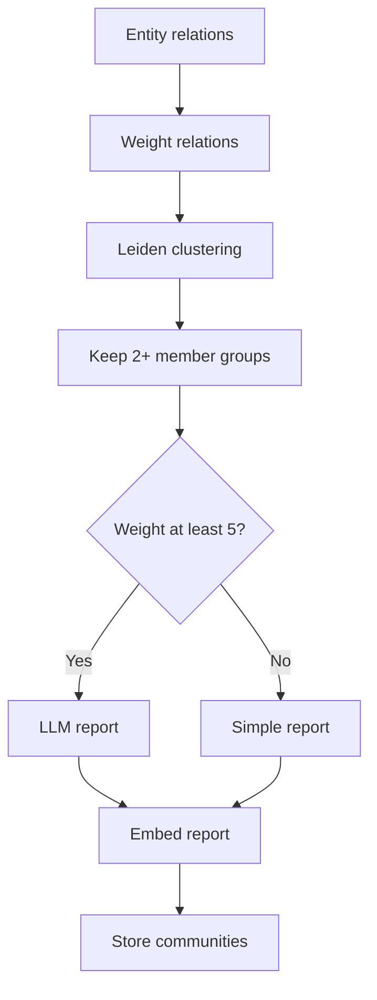

# Communities

A community is a cluster of related entities summarized for broad questions. The report complements source chunks and individual relations; it does not replace them as evidence.

## Why it exists

Some questions have no single chunk as an answer. "What are the main themes in this corpus?" needs a broad view. A list of every fact is too long to read.

A community report gives a compact view of one cluster through a title, summary, and findings. Retrieval can use the report to find a topic, then return the underlying entities or chunks for detail. Because an LLM can make errors in a report, treat its claims as a guide and compare them with source evidence.

## How it works

*Groups with many attested relations get an LLM report. Small groups get a simple one.*

Community detection is an explicit, graph-wide operation. `Graph.add` does not run it automatically, because clustering reads the full graph and replaces the previous partition.

When you call `Graph.detect_communities`, Agentic GraphRAG weights each entity relation by the number of source chunks that support it. Unsupported relations weigh zero. Leiden clustering creates a hierarchy, but the graph keeps only level 0 of the hierarchy and groups with at least two entities.

For each group, the graph sums its internal relation weights. Groups with a total weight of at least 5 get an LLM report with a title, summary, rating, reason, and findings. Smaller groups get a simple report whose title lists the three top members and whose rating is half the internal weight, capped at 10. If the `llm` extra is not installed, the graph uses the simple report and logs a warning. If an LLM call fails, the graph uses the simple report for that batch and records one failure for each community in it.

The graph embeds each report title and summary for retrieval. Applying the result replaces the previous communities rather than merging two partitions.

A dry run is the default. It returns the groups without reports.

## Example

Seven short documents about early computing give three communities.

| Members | Internal weight | Report | Title |
| --- | --- | --- | --- |
| Babbage, Lovelace, London, and two machines (5) | 6.0 | LLM | Early Computing Pioneers in London |
| Hopper, Philadelphia, UNIVAC compiler (3) | 3.0 | Simple | Grace Hopper, Philadelphia, UNIVAC compiler |
| Turing, Bletchley, Bombe (3) | 2.0 | Simple | Alan Turing, Bombe, Bletchley |

An LLM writes the first report, and an LLM can make mistakes. In one test run, a finding said that Ada Lovelace designed the Analytical Engine. The source text says that she wrote notes on it. Compare findings with the relations.

Design choices

Why weight relations by chunk count? A relation that many chunks state counts more. A relation without a source chunk cannot inflate a community.

Why decide the report type by internal weight and not by size? A small group with many attested relations can matter more than a large sparse group.

Why keep a simple report? It costs no LLM call and it is the same on every run. Most groups in a large graph are small.

Why keep only the first level? One level of groups is enough for retrieval. It also keeps the number of `Community` nodes small.

Why rebuild every time? A full rebuild gives one clean partition. There is no rule for merging an old partition with a new one.

Community detection reads the whole graph and replaces the previous partition. Running it on request keeps that cost out of ordinary ingestion and lets you decide when reports need a refresh.

## Related

- Guide: [Detect communities and read reports](../guides/detect-communities.mdx)
- Previous: [Matching and resolved entities](./resolved-entities.mdx)
- Concept: [Knowledge graph](./knowledge-graph.mdx)
- Reference: [Ingestion API](../api/ingestion/index.md)
