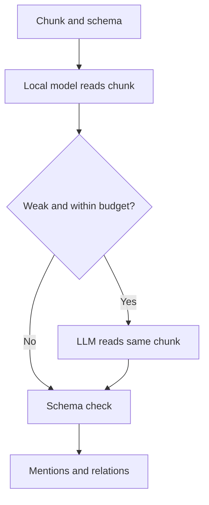

# Extraction

Extraction reads one chunk and lists its entities and relations. Every result must match a schema that you define.

## Why it exists

A chunk is plain text. A graph needs typed facts, such as "Charles Babbage designed the Analytical Engine". Extraction finds those facts.

A schema keeps the facts consistent. It names the valid entity types and relation types. It also names the pairs of types that each relation can join. An extractor cannot add a type that the schema does not declare.

Extraction can also cost a lot. An LLM that reads every chunk charges for every chunk. A small model on your machine reads every chunk at no API cost. An LLM can then read only the chunks where the small model looks weak, up to a budget.

## How it works

*The local model reads every chunk. The LLM reads the weakest chunks, up to a budget, and its entities combine with the local entities.*

1. The extractor receives one chunk and the schema.
2. The local model (GLiNER 2.5) reads the chunk once. It sees every entity type and every relation of the schema, each with its description. It returns entities with a text span and a confidence score. It also returns relations between them, with a score.
3. The extractor keeps an entity when its score is 0.5 or more. It keeps a relation when its score is 0.7 or more and the pair of entity types is one that the schema allows. When a type has a parent type, the model sees both. If it returns the same words under both, the extractor keeps the label with the higher score. On a tie it keeps the child.
4. The extractor does not throw away what it does not keep. It reports each dropped relation and each weak entity as a candidate, with the reason. You can turn this off.
5. After the local model has read every chunk of a batch, the graph ranks the chunks. A chunk is eligible when one of its entities scores below 0.75, when it has no entities and at least eight words, or when one of its entities has a type that declares properties. The weakest eligible chunks come first.
6. An LLM reads the eligible chunks in that order, until the budget is used. The budget is 20% of the chunks in a batch by default. The schema is part of the prompt. The LLM also receives the entities that the local model found. Its entities and the local entities combine into one result. An LLM entity with the name of a local entity keeps the local span and score. A local entity that the LLM did not return stays in the result. If the LLM call fails or gives no usable answer, the chunk keeps the local result.
7. The pipeline validates the result of every extractor, including an extractor that you write. Validation removes every entity whose label the schema does not declare. It removes every relation whose label, or whose pair of entity types, the schema does not declare. A pattern that names a parent type also covers the child types of that type. It removes every property that the schema does not declare. Cardinality and symmetry declarations are not enforced on extracted edges. The pipeline logs how many entities and relations it dropped.
8. The result is a list of mentions. A mention is not a graph node yet. It keeps its chunk, label, text, character span, and confidence.

You choose the LLM tier when you open a graph. If you pass no `llm_extractor`, no chunk goes to an LLM.

:::note
The local model reports spans and labels. It does not fill property values. When a kept entity has a type that declares properties, the result says so, so that an LLM extractor can read the chunk. Graph logs a warning when it is built in gliner mode and an entity type declares properties.
:::

## Example

A schema declares the entity types `Person`, `Machine`, and `City`. It declares the relations `DESIGNED` (Person to Machine) and `WORKED_IN` (Person to City). The local model reads two sentences.

| Text | Mentions | Relations |
| --- | --- | --- |
| Charles Babbage designed the Analytical Engine in London. | Charles Babbage (Person), Analytical Engine (Machine), London (City) | Charles Babbage DESIGNED Analytical Engine |
| Ada Lovelace worked in London and wrote notes on the Analytical Engine. | Ada Lovelace (Person), London (City), Analytical Engine (Machine) | Ada Lovelace WORKED_IN London |

The two sentences give six mentions. After resolution, they are four entities, because the two "London" mentions and the two "Analytical Engine" mentions have equal text.

Design choices

Why does the LLM see the local entities? A model that checks and completes a list does better than one that starts from nothing. The graph keeps the local span and score for an entity that both results find.

Why keep the local entities that the LLM did not return? The local model finds some entities that the LLM misses. Dropping them would lower recall, so the union keeps both.

Why use the lowest score and not the mean? One uncertain entity can be wrong while the others are right. The mean hides that entity. The lowest score finds it.

Why a budget? An LLM call costs more than a local call, and most chunks have at least one entity below 0.75. The budget sets an upper bound on the LLM cost of a run. The run report shows how many eligible chunks the budget left out.

Why escalate an empty result only for chunks of eight words or more? A short chunk with no entities is often correct. A long chunk with no entities is usually a miss.

Why validate after extraction? An LLM can invent a type or a property. The schema is the contract. Validation is the last step for every extractor, so the graph never receives an undeclared type.

Why one model call for entities and relations? The model scores both in one pass. A second pass for relations only costs time, and the relation endpoints would need a match to the entities anyway.

Why keep one label for words that return under a parent and a child type? Two labels on one span make two mentions of one thing. The higher score is the model's better guess, and the parent labels are added when the node is written.

Why read the model a second time at a lower score? A lower score changes which overlapping spans the model keeps, so the entities you keep must come from the first read. The second read only looks for weak spans to report.

## Related

- Guide: [Define a graph schema](../guides/define-a-graph-schema.mdx)
- Guide: [Extract and resolve entities](../guides/extract-and-resolve.mdx)
- How-to: [Control LLM cost during extraction](../guides/control-llm-cost-during-extraction.mdx)
- Next: [Entity resolution](./resolution.mdx)
- Reference: [Ingestion API](../api/ingestion/index.md)
