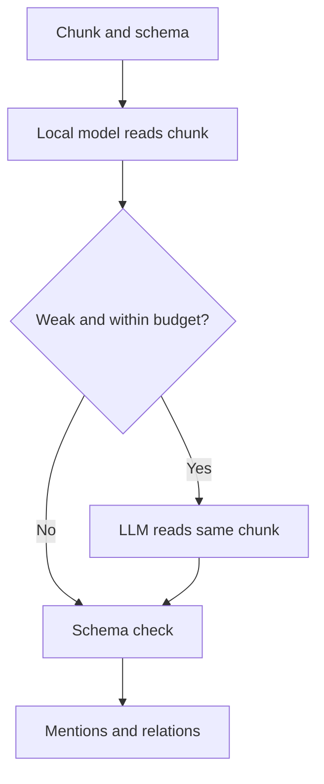

# Extraction

Extraction turns a chunk into entity and relation mentions, not graph nodes. The schema defines which types and relation patterns the extractor can return; later resolution decides which mentions share an entity.

## Why it exists

A chunk is plain text. Extraction turns statements in that text into typed facts, such as "Charles Babbage designed the Analytical Engine". It records where each mention came from so later stages can validate and resolve it.

A schema keeps the facts consistent. It names the valid entity types and relation types. It also names the pairs of types that each relation can join. An extractor cannot add a type that the schema does not declare.

The trade-off is coverage against cost. A local model can screen every chunk without API calls, while an LLM can add context-sensitive results at additional cost. Hybrid mode sends selected chunks to the LLM, subject to an escalation budget; GLiNER-only mode avoids those calls, while LLM-only mode sends chunks directly to the LLM.

## How it works

*The local model reads every chunk. The LLM reads the weakest chunks, up to a budget, and its entities combine with the local entities.*

1. The extractor receives one chunk and the schema.
2. The local model (GLiNER 2.5) reads the chunk. When candidates are on, it makes a second call that reports spans scoring just under the entity threshold. It sees every entity type and every relation of the schema, each with its description. It returns entities with a text span and a confidence score. It also returns relations between them, with a score.
3. The extractor keeps an entity when its score is 0.5 or more. It keeps a relation when its score is 0.7 or more and the pair of entity types is one that the schema allows. When a type has a parent type, the model sees both. If it returns the same words under both, the extractor keeps the label with the higher score. On a tie it keeps the child.
4. The extractor reports rejected relations and weak entities as [candidates](./candidates.mdx), with a reason. Validation also reports each undeclared property as a property candidate. Property candidates occur only on chunks read by the LLM tier and only when the schema declares properties. You can turn candidate reporting off.
5. In hybrid mode, after the local model has read every chunk of a batch, the graph ranks eligible chunks. With default settings, a chunk is eligible when a kept entity scores below 0.75, when it has no kept entities and at least eight words, or when a kept entity's type has declared or inherited properties. The weakest eligible chunks come first.
6. An LLM reads the eligible chunks in that order, until the budget is used. The budget is 20% of the chunks in a batch by default. The schema is part of the prompt. Its entities and the local entities combine into one result. An LLM entity with the name of a local entity keeps the local span and score. A local entity that the LLM did not return stays in the result. If the LLM call fails or gives no usable answer, the chunk keeps the local result.
7. The pipeline validates the result of every extractor, including an extractor that you write. Validation removes every entity whose label the schema does not declare. It removes every relation whose label, or whose pair of entity types, the schema does not declare. A pattern that names a parent type also covers the child types of that type. It removes undeclared properties from entities and returns them as property candidates. Cardinality and symmetry declarations are not enforced on extracted edges. The pipeline logs how many entities, relations and properties it dropped.
8. The result is a list of mentions. A mention is not a graph node yet. It keeps its chunk, label, text, and character span. A mention from the local model also keeps a confidence score. A mention from an LLM has none.

The graph's extraction mode and available LLM settings determine whether an LLM reads chunks. In `hybrid` or `llm` mode, omitting `llm_extractor` still lets the graph build its default BAML extractor from configured environment settings. If those settings are absent, hybrid mode runs locally; use `mode="gliner"` to disable LLM extraction explicitly. See [Choose an extraction mode](../guides/choose-an-extraction-mode.mdx) for the mode and model settings.

:::note
The local model reports spans and labels, but does not fill property values. A kept entity with declared or inherited properties makes its chunk eligible for LLM review, subject to the hybrid budget. Graph logs a warning when it runs in GLiNER-only mode with declared properties. The LLM reports labels, names, and property values; the extractor finds the names' spans in the text.
:::

## Example

A schema declares the entity types `Person`, `Machine`, and `City`. It declares the relations `DESIGNED` (Person to Machine) and `WORKED_IN` (Person to City). The local model reads two sentences.

| Text | Mentions | Relations |
| --- | --- | --- |
| Charles Babbage designed the Analytical Engine in London. | Charles Babbage (Person), Analytical Engine (Machine), London (City) | Charles Babbage DESIGNED Analytical Engine |
| Ada Lovelace worked in London and wrote notes on the Analytical Engine. | Ada Lovelace (Person), London (City), Analytical Engine (Machine) | Ada Lovelace WORKED_IN London |

The two sentences give six mentions. After resolution, they are four entities, because the two "London" mentions and the two "Analytical Engine" mentions have equal text.

Design choices

Why keep the local span and score for an entity that both results find? The local model reports a span and a score for every entity, so the graph uses them when the LLM returns the same entity.

Why keep the local entities that the LLM did not return? The local model finds some entities that the LLM misses. Dropping them would lower recall, so the union keeps both.

Why use the lowest score and not the mean? One uncertain entity can be wrong while the others are right. The mean hides that entity. The lowest score finds it.

Why a budget? An LLM call costs more than a local call, and most chunks have at least one entity below 0.75. The budget sets an upper bound on the LLM cost of a run. The run report shows how many eligible chunks the budget left out.

Why escalate an empty result only for chunks of eight words or more? A short chunk with no entities is often correct. A long chunk with no entities is usually a miss.

Why validate after extraction? An LLM can invent a type or a property. The schema is the contract. Validation is the last step for every extractor, so the graph never receives an undeclared type.

Why one model call for entities and relations? The model scores both in one pass. A second pass for relations only costs time, and the relation endpoints would need a match to the entities anyway.

Why keep one label for words that return under a parent and a child type? Two labels on one span make two mentions of one thing. The higher score is the model's better guess, and the parent labels are added when the node is written.

Why read the model a second time at a lower score? A lower score changes which overlapping spans the model keeps, so the entities you keep must come from the first read. The second read only looks for weak spans to report.

## Related

- Guide: [Define a graph schema](../guides/define-a-graph-schema.mdx)
- Guide: [Extract and resolve entities](../guides/extract-and-resolve.mdx)
- How-to: [Control LLM cost during extraction](../guides/control-llm-cost-during-extraction.mdx)
- How-to: [Turn candidates off](../guides/turn-off-candidates.mdx)
- Explanation: [Candidates](./candidates.mdx)
- Next: [Entity resolution](./resolution.mdx)
- Reference: [Run statistics](../reference/run-stats.mdx)
- Reference: [Ingestion API](../api/ingestion/index.md)
