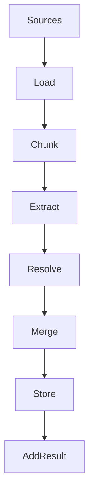
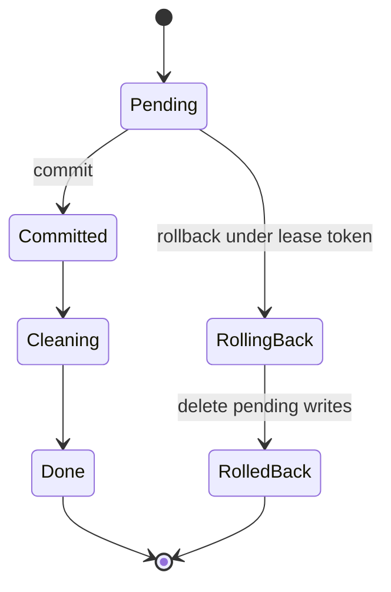

# Ingestion pipeline

`Graph.add` turns sources into graph content in six stages. One call handles text, files, folders and prebuilt documents.

## Why it exists

Ingestion has many parts that can fail: a corrupt file, a slow model call, a lost database connection. One pipeline gives every source the same steps, the same summary and the same failure rules.

The same pipeline also backs `Graph.update`. New content and changed content take the same path, so they behave the same way.

## How it works

*Each stage hands its output to the next. The result reports every stage.*

1. Load. A loader reads each source and makes documents. The error policy decides what happens when a source fails. See [Loading documents](./loading.mdx).
2. Chunk. A chunker splits each document into chunks. See [Chunking](./chunking.mdx).
3. Extract. The extractor (see [Extraction](./extraction.mdx)) reads each chunk and finds entities and relations. It drops any entity or relation that the schema does not allow.
4. Resolve. The resolver (see [Entity resolution](./resolution.mdx)) looks for mentions that name the same thing. It first compares exact names against the whole store. It then compares the remaining mentions with each other and with stored entities. A language model reads only the pairs that stay unclear, and the number of such reads has a cap.
5. Merge. For entities that share a name, Agentic GraphRAG decides each property value and joins the chunk ids that mention them. Fuzzy, embedding and LLM matches are not merged. See [Matching and resolved entities](./resolved-entities.mdx).
6. Store. The graph store (see [Graph storage](./graph-storage.mdx)) writes chunks, documents, entities, relations and the edges between them. The embedder adds vectors. An optional vector store gets a copy.

`Graph.add` returns an `AddResult`. It holds one summary for each stage: ingestion, chunking, extraction, resolution, merge and storage. Each summary lists failures. A failure carries a trace id, so you can find the full record in your tracing tool.

### Crash safety

`add`, `update` and `delete_document` each run as a job. A job is one call. The job tags every write with its own id, and search skips tagged writes. Nothing becomes visible until the job commits.

*A job that stops before its commit rolls back. A job that stops after it rolls forward.*

If a process stops during a call, the next `Graph.open` finds the unfinished job. It removes the tagged writes of a job that had not committed. It finishes the cleanup of a job that had. A running job renews a lease of 60 seconds by default. Another process takes over only after the lease runs out. A new job on a document whose earlier job is still pending or rolling back first rolls that earlier job back, so no rows from a crashed run remain. Only a job that has already finished is taken over directly.

Rollback starts only while the job is still pending under the worker's lease token. The job enters `rolling_back` before its staged vectors and graph rows are deleted. If the worker stops during rollback, `Graph.open` finishes it after the lease expires. If a commit fails with an unclear result, the worker reads the job. A committed job is never rolled back; the worker finishes its cleanup instead. Commit and rollback find a job's rows through an index on the pending tag, so their cost follows the size of the job, not the size of the graph. Two documents that add the same relation at the same time each create their own copy. The commit step merges the copies, so one relation remains and keeps the evidence from both documents.

Workers that share a graph must run the same version during an upgrade. Use the new version to recover any `rolling_back` jobs before you downgrade.

## How Agentic GraphRAG decides a document is unchanged

`Graph.update` compares the values that it stored for the document with the new values. The differences decide what runs.

| What differs | What `Graph.update` does |
|---|---|
| Nothing | Nothing runs. The call returns `no_op=True`. |
| Only the extraction fingerprint | It extracts the entities again on the same chunks. The chunks are not embedded again. Entities that only the old run produced are removed. Relations lose the evidence of this document's old run, and a relation with no evidence left is removed. |
| The content hash, the chunker fingerprint or the schema fingerprint, or no chunk is open | It writes a new version of the document with new chunks, and the new chunks are embedded. The old version closes when the job commits, and entities that only the old version produced are removed. |

The values come from the document and its chunks:

| Value | What changes it |
|---|---|
| Content hash | An edit to the text of the document. |
| Chunker fingerprint | A change to the chunk size, the minimum chunk size or the tokenizer. |
| Schema fingerprint | A change to the structure of the schema: entity types, parents, properties, relations, patterns, cardinality or symmetry. The schema name, the schema version and the descriptions do not change it. |
| Extraction fingerprint | A change to a description, an extraction setting, the extraction mode, the LLM model name or the heading path option of `BAMLExtractor`. |
| Open chunk | A deleted document has none. |

The Document node stores the schema name, the schema version, the schema fingerprint and the extraction fingerprint. Each chunk stores the chunker fingerprint, the schema fingerprint and the extraction fingerprint. The job writes these values at its commit. A job that fails leaves the old values in place.

The escalation budget is not part of the extraction fingerprint, so a change of the budget does not extract a document again. The chunks do not depend on the extraction settings, so a re-extraction keeps the chunks and their embeddings. A change of the chunker or the schema structure writes a new version, so the document is chunked and embedded again.

## Example

You call `Graph.add` with a folder of 200 files and `ErrorPolicy.SKIP`. One file ends in `.dat`, and no loader reads that extension. The loader skips it and counts it. The other 199 files become documents and chunks. The `AddResult` shows 199 documents, 1 skipped source, and the number of entities that extraction found.

Design choices

Why one `add` call for every input? Text, files and prebuilt documents differ only in the first stage. After it, the pipeline is the same, so the behavior is the same.

Why does extraction run on each chunk alone? A relation between two entities that sit in different chunks is not captured. A larger chunk size gives the extractor more context. The [Chunking](./chunking.mdx) page describes the size.

Why a job and not a database transaction? Extraction makes slow model calls. A database transaction cannot stay open through them. The job tags writes instead, and one short transaction commits them.

Why does the pipeline write last? Resolution needs every mention of the batch before it can decide which are the same. Writing after that step avoids writing an entity twice.

Why does the error policy apply to each source? One bad file must not stop a run of thousands. `RAISE` stops at the first failure. `SKIP` counts the failure. `QUARANTINE` records the reason.

## Related

- [Loading documents](./loading.mdx) and [Chunking](./chunking.mdx) describe the first two stages.
- [Ingest documents](../guides/ingest-documents.mdx) shows how to call `Graph.add`.
- [Update and delete documents](../guides/update-and-delete-documents.mdx) shows the same pipeline for changes.
- [Trace spans](../reference/trace-spans.mdx) lists the spans of each stage.
