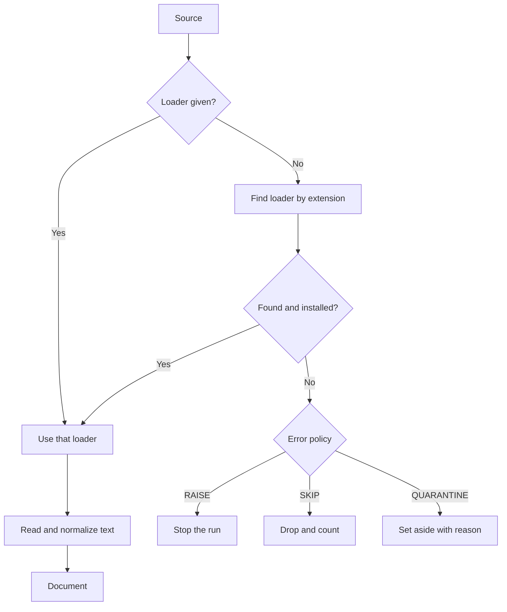

# Loading documents

A loader converts a source into documents with normalized text, identity, and structure. The loader registry usually selects a parser by extension, while record formats can produce one document per row or record.

## Why it exists

Later ingestion stages need a consistent document model, even when sources differ. The loader preserves useful structure such as headings and tables while recording a stable identity for updates. Parser choice affects that identity and the source locations available to citations.

## How it works

*The loader comes from you or from the extension. A source that fails follows the error policy.*

1. Pick. You can pass a loader for a single file. Otherwise Agentic GraphRAG looks up the extension, and each extension has one loader. If that loader needs a package that is not installed, the source fails with a missing-package error.
2. Read. The loader detects the text encoding. It removes the byte-order mark, changes line endings to LF, and applies Unicode form NFKC. You can change each of these values.
3. Build. The loader makes a document. A document holds the text, the source location, the format, a content hash, the loader name and its sections. A section holds a heading, its depth and the units of content under it: paragraphs, lists, tables and figures.

### Prose and record sources

A prose source makes one document for each file. A record source makes one document for each record: a CSV row, a JSON Lines line, or an element of a JSON array. A record document takes its text from one column. You can name the column. If you do not, Agentic GraphRAG uses a column called `text`, `body`, `content` or `description`, and otherwise the last column.

### Supported formats

| Format | Extensions | Loader |
| --- | --- | --- |
| Plain text | `.txt`, `.log` | Core, one section |
| XML | `.xml` | Core, the text of the elements |
| Markdown | `.md`, `.markdown` | Docling |
| HTML | `.html`, `.htm` | Docling |
| AsciiDoc | `.adoc`, `.asciidoc` | Docling |
| Word, PowerPoint, Excel | `.docx`, `.pptx`, `.xlsx` | Docling |
| PDF | `.pdf` | Docling, needs the `docling` extra |
| Images | `.png`, `.jpg`, `.jpeg`, `.tif`, `.tiff`, `.bmp` | Docling, needs the `docling` extra |
| CSV and TSV | `.csv`, `.tsv` | Core, one document per row or one for the table |
| JSON Lines | `.jsonl`, `.ndjson` | Core, one document per line |
| JSON | `.json` | Core, one document per array element, or one for an object |
| Chat files | `.jsonl`, `.ndjson`, `.json` | Chat loader, passed by you, one section per message |

Docling reads Markdown, HTML, AsciiDoc, Word, PowerPoint and Excel files without a model, and the base install includes it. PDF and image files need the layout and table models, which the `docling` extra installs. Docling does not read CSV files, because a CSV row needs its own identity. The chat loader has no extension of its own, because `.jsonl` and `.json` already belong to the record loaders. You pass it for a single file.

### Sections

A section is a heading and the content under it. A PDF gets its heading depth from its bookmarks. A PDF without bookmarks gets it from numbered headings, such as "3.2 Results", but only when it has at least three headings and at least half are numbered; otherwise its headings stay at depth 1. A document with no headings has one section with an empty heading. A record row has no sections. A file in Markdown, HTML or Word has no page numbers, so its chunks have no page spans.

## Example

You add `report.pdf` and `notes.md` in one call. The registry sends both files to Docling. Both become prose documents with sections. If the `docling` extra is missing, the PDF fails with a missing-package error, and the error policy decides whether the run goes on. The Markdown file still loads.

Design choices

Why does a document keep two hashes? The content hash is the hash of the document text, and it decides whether a document changed. A Docling document also records `source_hash`, the hash of the raw file bytes. Because Docling can export the same file as different text between versions, a Docling upgrade can change the content hash of an unchanged file and create a new version of it.

Why do offsets point into the normalized text? Every chunk offset counts characters in the text after normalization. If you need offsets that match the raw source, keep the text as it is with `Normalization(bom="keep", newline="keep", unicode_form="none")`.

Why does each extension have its own loader? Different parsers preserve different structure. Docling reads AsciiDoc, Markdown, and HTML structure, while the core CSV loader gives each row its own identity. Choosing by extension avoids treating every installed parser as an equally good fit.

Why is docling an extra? Optional formats ship behind extras. A text-only install stays small.

## Related

- [Chunking](./chunking.mdx) describes the next stage.
- [Ingest documents](../guides/ingest-documents.mdx) shows how to add each kind of source.
- [Loaders API](../api/loaders/index.md) lists every loader and read option.
