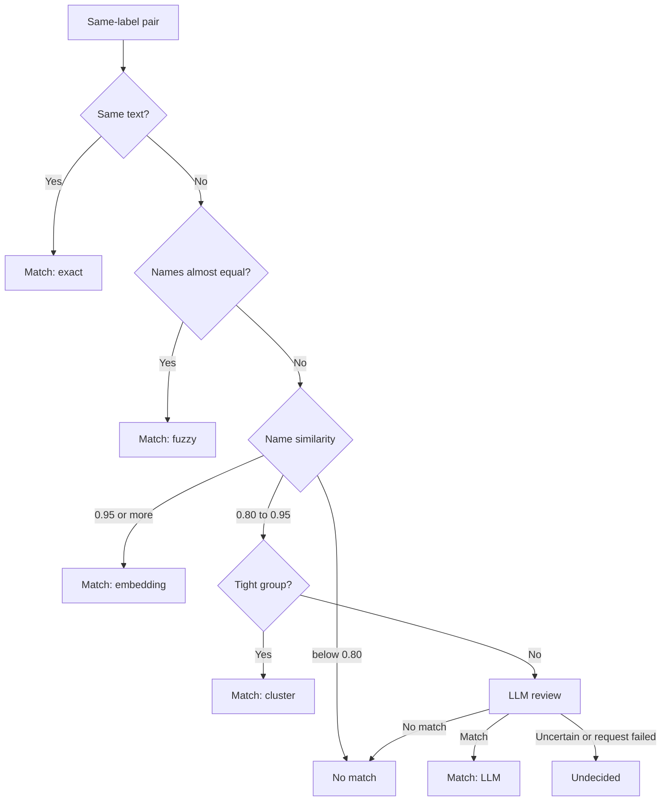

# Entity resolution

Entity resolution decides whether extracted mentions refer to the same real-world entity. The ingestion pipeline records those decisions and derives resolved entities without rewriting the original entities' facts. See [Matching and resolved entities](./resolved-entities.mdx) for how those records work.

## Why it exists

One thing has many names. A corpus can say "Charles Babbage", "Babbage Charles", and "C. Babbage". A graph with three nodes splits the evidence. A search then finds only a part of it.

A wrong match can mix facts from two entities, while a missed match can be reconsidered later. The resolver therefore treats uncertain pairs differently from rejected pairs. If no tier can decide, such as when an LLM request fails, the pair stays undecided and an existing match remains in place.

## How it works

*A pair goes down the tiers. The first tier that is sure decides.*

1. Only mentions with the same label are compared. The label is the type of the mention, not a parent type. A `Vendor` is never compared with an `Organization`. A `Person` is never compared with a `Location`.
2. Exact tier. Two mentions match when their text is equal after trimming spaces and ignoring letter case.
3. Fuzzy tier. The tier compares the words of both names and ignores their order. A score of 0.97 or more is a match. A lower score is not a rejection. It only means that the fast path does not apply.
4. Embedding tier. Each name becomes a vector. A cosine similarity of 0.95 or more is a match. A similarity below 0.80 drops the pair. A similarity from 0.80 to 0.95 makes the pair ambiguous.
5. Cluster tier. Ambiguous pairs are grouped by average similarity. A tight group is a match without an LLM call.
6. LLM tier. An LLM reads each remaining pair with its context. It answers match, no match, or uncertain. Only a match merges. A failed request also leaves the pair undecided. The LLM sees at most 500 pairs for each label, most similar first; entity indices break ties. Pairs over the cap stay undecided and are counted in the resolution result.

The tier thresholds trade speed and cost against judgment quality. Cheap exact and name-based checks handle clear cases first; only ambiguous pairs reach the LLM, and the per-label cap leaves some pairs undecided rather than allowing unbounded calls. If no LLM is configured, the remaining pairs stay undecided. A resolution call logs one warning, and `reevaluate` keeps existing match edges for those pairs.

## Two scopes

`Graph.add` compares the mentions of one call with each other and with similar entities that the graph already stores. `Graph.consolidate` runs the same tiers over every entity in the graph, when you ask for it. If you added data before an LLM was configured, use it. The guide [Consolidate duplicates](../guides/consolidate-duplicates.mdx) shows how.

Entities that two documents create at the same time are resolved after both jobs commit. Each add resolves its mentions only against data that is already committed, so a concurrent add cannot see an entity that has not committed yet. After a job commits, it resolves the entities it created against everything committed so far, so near-duplicate names such as "Acme Corporation" and "Acme Corp" still end in one resolved entity.

## Example

| Pair | Deciding tier | Result |
| --- | --- | --- |
| "Babbage Charles" and "Charles Babbage" | Fuzzy (score 1.0) | Match |
| "C&#46; Babbage" and "Charles Babbage" | LLM | Match: "C&#46;" is a standard short form of "Charles" |
| "Analytical Engine" and "Difference Engine" | LLM | No match: two different machines |
| "Cambridge" (Location) and "Cambridge" (Organization) | Not compared | Different labels |

Design choices

Why zones and not a chain of vetoes? A low fuzzy score never rejects a pair. "Ada King" and "Ada Lovelace" share few characters, but they name one person. The embedding and LLM tiers still get to see the pair.

Why cluster before the LLM? A tight group of similar names needs no judgment. Grouping first sends fewer pairs to the LLM.

Why cap the LLM pairs for each label? The cap bounds the cost. One call makes at most ceil(L × 500 ÷ 10) LLM requests for L labels.

Why does "unsure" mean no merge? A missed match is recoverable with `Graph.consolidate`. An uncertain answer is not a rejection, so `Graph.reevaluate` does not remove a match because the model was unsure.

Why compare only equal labels? A city and a company can have the same name. Keeping labels apart stops a merge across types.

## Related

- Guide: [Consolidate duplicates](../guides/consolidate-duplicates.mdx)
- Guide: [Extract and resolve entities](../guides/extract-and-resolve.mdx)
- Previous: [Extraction](./extraction.mdx). Next: [Matching and resolved entities](./resolved-entities.mdx)
- Reference: [Ingestion API](../api/ingestion/index.md)
