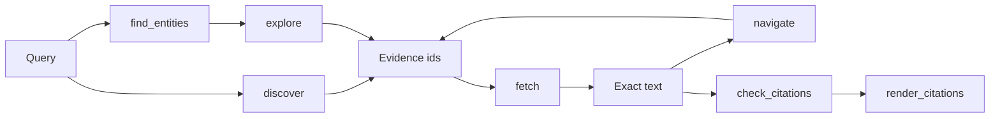
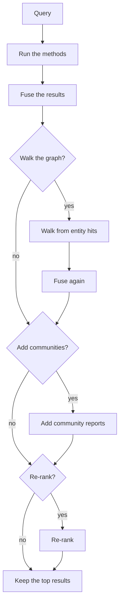
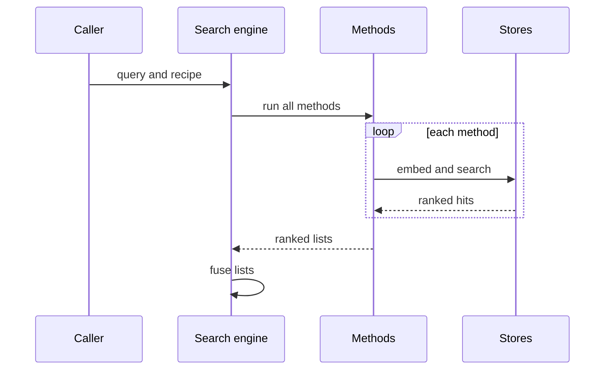
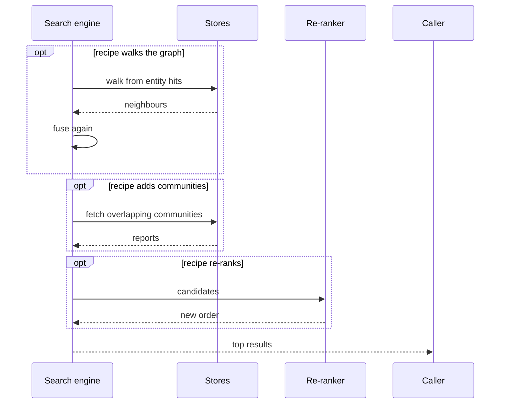

# Retrieval

Agentic GraphRAG has two ways to retrieve. The evidence functions in `agrag.evidence` find passages, fetch their exact text, move between neighbouring passages, explore entity relations, and check citations. The built-in agent and the MCP server use them. `SearchEngine` runs named recipes that combine search methods over entities, chunks, and community reports, for code that wants ranked results from the graph.

## Why it exists

Graph data answers questions in different ways. A fact can sit in a source passage, on an entity, in a relation between entities, or in a summary of a whole topic. No single search finds all four. A name lookup works for "Ada Lovelace". It does not work for "the main themes in this corpus".

An answer that cites its sources needs more than a ranked list. The evidence functions give every passage an id that names one version of one document, return the exact text behind an id, and check each citation against what was fetched. A caller fixes the set of readable documents once, and every function applies that scope inside its queries.

## Evidence retrieval

*Search and entity functions return evidence ids. Fetch returns the text behind an id. Citations are checked against the ids that were fetched.*

1. Discover. `discover` searches the text of the current document versions in scope. It runs a keyword search, a vector search, or both, and combines hybrid results with Reciprocal Rank Fusion. Each hit has an evidence id, a snippet, a title, and a location. The result carries a status, and it says when a search leg failed or the candidate list was cut.
2. Fetch. `fetch` returns the exact text for each id. A chunk id returns the stored chunk text. A span id returns the requested character range, and a result that covers only part of the range is marked partial. The result says whether the version is current or superseded, so an id keeps working after the document is updated.
3. Navigate. `navigate` moves from a passage to its parent section, its children, its siblings, the previous or next chunk, or the cells around a table.
4. Find entities. `find_entities` searches entity names by keyword and entity embeddings by meaning, and returns each entity with up to three supporting passages. `explore` follows relations outward from an entity and marks each edge as an assertion that a visible passage supports, or as a path between entities.
5. Check. `check_citations` compares cited ids with the ids that were fetched in scope. A valid citation was fetched. `render_citations` turns valid ids into numbered references with a Sources list.

An evidence id names a document, a prefix of the content hash of one version, and a chunk or character span. The agent calls these functions as tools, and the MCP server exposes them as `search_evidence`, `fetch_evidence`, `navigate`, `find_entities`, `explore`, and `check_citations`. See [Find and cite evidence](../guides/find-and-cite-evidence.mdx) to call them from Python.

## Recipe search

`SearchEngine` runs a recipe over the graph.

### How a recipe runs

*The engine runs these steps in order. A diamond step runs only when the recipe asks.*

1. Run the methods. The recipe names one or more methods. The engine runs them at the same time. If one method fails, the others still return results.
2. Fuse. The engine merges the ranked lists into one list and removes duplicates.
3. Walk the graph (optional). The engine follows relations outward from the entity hits and fuses the neighbours into the list.
4. Add communities (optional). The engine adds the reports of communities that overlap the entities found.
5. Re-rank (optional). A cross-encoder model, or the graph distance to the top entity hits, sets a new order.
6. Cut. The engine keeps the top results, up to the limit of the recipe.

*One query, part 1: the engine runs the methods and fuses their ranked lists.*

*One query, part 2: optional steps widen and re-order the fused list. Then the engine returns the top results.*

### Methods

| Method | What it finds |
|---|---|
| `entity` | Entities and resolved entities whose embedding is closest to the query. |
| `chunk` | Passages of source text. Each hit is one chunk, with the headings above it. |
| `community` | Reports on topics. |

The graph walk is a step, not a method. A recipe switches it on.

### Recipes

A recipe is a named list of configuration values. It is data, so you can read it and copy it.

| Recipe | Methods | Extra steps | Results |
|---|---|---|---|
| `ENTITY` | entity | none | 10 |
| `CHUNK` | chunk | none | 10 |
| `HYBRID` | entity, chunk | none | 10 |
| `HYBRID_RERANKED` | entity, chunk | community reports, cross-encoder re-rank | 10 |
| `GRAPH_EXPAND` | entity | graph walk, community reports | 20 |
| `THEMATIC` | community | none | 5 |

### Fusion

Reciprocal Rank Fusion scores an item by its rank in each list, not by its raw score. `RETRIEVAL_RRF_K` sets the constant for `SearchEngine`, and evidence discovery uses a fixed constant of 60. An item found by multiple methods can outrank an item found by one method. Each method gives an item one vote at its best rank, so duplicate hits from one method do not add weight.

Fusion runs even when a recipe has one method. It also removes duplicates, so the re-ranker never sees the same item twice.

### Filters

A filter limits a search to matching items. It can match entity label, document, property value, or relation type. Labels apply to entity search only. Relation types limit the graph walk. Document and property filters apply to entity and chunk search.

### A worked example

The query is "Who worked with Babbage?" and the recipe is `HYBRID`. Entity search ranks the entities Charles Babbage and Ada Lovelace. Chunk search returns the chunk that names both. Fusion merges the two lists. The caller gets five results: four entities and one chunk. The chunk carries its heading path, so the caller can show where it came from.

Design choices

Why fuse ranks and not scores? A vector search, a keyword search, and a graph walk score on different scales. Ranks compare across methods. Scores do not.

How do community reports survive the re-rank? With the cross-encoder, the recipe keeps up to three slots for community reports after the re-rank, so the re-rank cannot push every report out of the results.

Why does one failed method not fail the search? A timeout in one method must not hide good results from another. The engine logs the failure and records it on the trace. If every method fails, the engine raises an error. Every method follows one rule. With a positive limit, it returns an empty list only when the search ran and found nothing. It raises on any failure it cannot recover from.

## Related

- Guide: [Find and cite evidence](../guides/find-and-cite-evidence.mdx), [Retrieve and answer](../guides/retrieve-and-answer.mdx)
- Guide: [Run the MCP server](../guides/run-the-mcp-server.mdx)
- Concepts: [Chunking](./chunking.mdx), [Communities](./communities.mdx), [Graph storage](./graph-storage.mdx), [Agent loop](./agent-loop.mdx)
- Reference: [Retrieval API](../api/retrieval/index.md), [Configuration](../reference/configuration.mdx)
