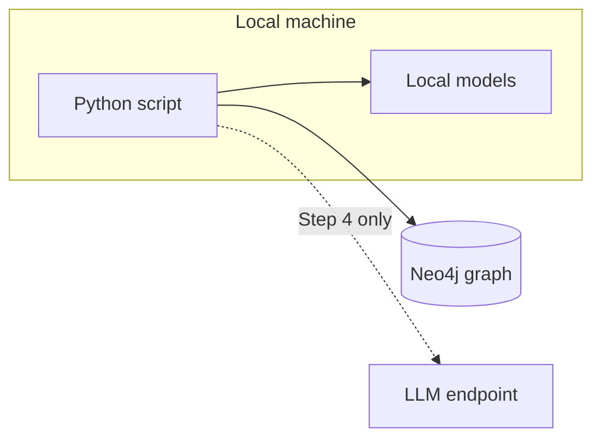

# Quickstart

In this tutorial, you build a knowledge graph from one document, look at what Agentic GraphRAG stored, and ask the built-in agent a question about the document. The agent answers with numbered sources.

The tutorial takes about 10 minutes on a typical connection. Most of the time goes to the first download of libraries and models.

## What you need

- Python 3.11 or newer, and [uv](https://docs.astral.sh/uv/) 0.6.9 or newer.
- A Neo4j database, version 5.23 or newer. Step 1 shows two ways to get one.
- An OpenAI-compatible LLM endpoint and API key for the agent in step 4.

## What runs where

Your script runs on your machine, together with the embedding and extraction models. The graph lives in Neo4j. Only the agent calls an LLM.



*The script and the models run locally. The agent step calls your LLM endpoint.*

## Step 1: Get a Neo4j database

Make a folder for the tutorial:

```bash
mkdir agrag-quickstart
cd agrag-quickstart
```

Choose one of the two options and create a file named `.env` in the folder.

<details>
<summary>Use a free Neo4j Aura instance</summary>

1. Open [console.neo4j.io](https://console.neo4j.io) and sign in.
2. Create a free AuraDB instance.
3. Download the credentials file when Aura shows the password. Aura shows the password one time.
4. Wait until the instance is running.
5. Copy the credentials file into the tutorial folder and rename it `.env`.

The credentials file sets `NEO4J_URI`, `NEO4J_USERNAME`, `NEO4J_PASSWORD`, and `NEO4J_DATABASE`. The URI starts with `neo4j+s://`.

</details>

<details>
<summary>Run Neo4j on your machine with Docker</summary>

Start a Neo4j container. It needs about 30 seconds before it accepts connections.

```bash
docker run -d --name agrag-neo4j -p 7687:7687 \
  -e NEO4J_AUTH=neo4j/agrag-quickstart neo4j:5.26.0-community
```

Create the `.env` file:

```text
NEO4J_URI=bolt://localhost:7687
NEO4J_USERNAME=neo4j
NEO4J_PASSWORD=agrag-quickstart
NEO4J_DATABASE=neo4j
```

</details>

Add your LLM endpoint to the same `.env` file. The agent reads these values:

```text
AGENT_LLM_BASE_URL=https://your-endpoint.example.com/v1
AGENT_LLM_API_KEY=your-api-key
AGENT_LLM_MODEL_ID=your-model-id
```

## Step 2: Install Agentic GraphRAG

Create a virtual environment and install the packages:

```bash
uv venv
source .venv/bin/activate   # On Windows: .venv\Scripts\activate
uv pip install "agentic-graphrag[neo4j,extract,agents] @ git+https://github.com/ontogr/agentic-graphrag.git@main" --torch-backend=auto
```

The `--torch-backend=auto` flag picks the PyTorch build for your machine, such as a CPU-only build when it finds no GPU. See [Installation](./installation.mdx#alternative-pytorch-distributions) for the details.

## Step 3: Add a document

Save a short document as `policy.md`:

```markdown
# Vendor policy

## Approval

A purchasing manager approves every vendor contract above 10,000 dollars.
The finance team reviews the contract terms before the manager signs.

## Renewal

Contracts renew once a year. The manager must confirm each renewal in writing.
```

Save this script as `build_graph.py`. It opens a graph with the `operations` schema and adds the document with local GLiNER extraction:

```python
import asyncio
from pathlib import Path

from agrag.embedding import build_embedder
from agrag.graphdb import build_graph_store
from agrag.ingestion import ExtractionSettings, Graph


async def main() -> None:
    document = Path("policy.md").resolve()
    store = build_graph_store("neo4j")
    embedder = build_embedder("ibm-granite/granite-embedding-small-english-r2")
    try:
        graph = await Graph.open(
            schema="operations",
            graph_store=store,
            embedder=embedder,
            extraction_settings=ExtractionSettings(mode="gliner"),
            max_llm_pairs=0,
        )
        result = await graph.add(document, return_chunks=True)
        print("documents:", result.ingestion.documents)
        print("chunks:", len(result.chunks))
        print("entities extracted:", result.extraction.entities_extracted)
        print("relations extracted:", result.extraction.relations_extracted)
    finally:
        await store.close()


asyncio.run(main())
```

Run it:

```bash
python build_graph.py
```

The first run downloads the embedding and extraction models. The script prints the number of documents, chunks, entities, and relations that this run produced. The document is one document with at least one chunk.

## Step 4: Ask a question

Save this script as `ask.py`. It builds the agent and limits it to the document you added. The scope uses the resolved path of the file, because a file document's key is its resolved path.

```python
import asyncio
from pathlib import Path

from agrag.agents import AgentLLMSettings, build_agent
from agrag.embedding import build_embedder
from agrag.graphdb import build_graph_store


async def main() -> None:
    document = Path("policy.md").resolve()
    store = build_graph_store("neo4j")
    embedder = build_embedder("ibm-granite/granite-embedding-small-english-r2")
    try:
        agent = build_agent(
            graph_store=store,
            embedder=embedder,
            scope=frozenset({str(document)}),
            project_id="quickstart",
            agent_id="researcher",
            llm_settings=AgentLLMSettings.from_openai_compatible_env(),
        )
        result = await agent.ainvoke(
            {
                "task_name": "vendor-policy",
                "question": "Who approves a vendor contract? Cite your sources.",
            }
        )
        print(result["status"])
        print(result["answer"])
    finally:
        await store.close()


asyncio.run(main())
```

Run it:

```bash
BAML_LOG=off python ask.py
```

`BAML_LOG=off` stops BAML from printing every LLM call. On Windows PowerShell, set `$env:BAML_LOG = "off"` first.

The script prints the run status and the answer. The status is `answered` when the agent found evidence and its citations check out. The answer ends with a Sources list, and each number in the text refers to a passage the agent read. The wording of the answer varies with your model.

Run the script again with the same `task_name`. Agentic GraphRAG continues the task from its recorded events and steps.

## Step 5: Look at the graph

Agentic GraphRAG stores the graph in Neo4j, so you can query it with Cypher. Save this script as `inspect_graph.py`. It lists the entities that extraction found:

```python
import asyncio

from agrag.graphdb import build_graph_store


async def main() -> None:
    store = build_graph_store("neo4j")
    await store.connect()
    try:
        rows = await store.execute_read(
            "MATCH (e:_Node) "
            "WHERE NOT e:Chunk AND NOT e:Document AND NOT e:Community "
            "AND NOT e:ResolvedEntity "
            "RETURN [l IN labels(e) WHERE l <> '_Node'][0] AS label, "
            "e.name AS name ORDER BY label, name"
        )
        for row in rows:
            print(row["label"], "|", row["name"])
    finally:
        await store.close()


asyncio.run(main())
```

Run it:

```bash
python inspect_graph.py
```

Every node that Agentic GraphRAG writes has the label `_Node`. The query skips chunk, document, community, and resolved-entity nodes, so only entities remain.

## What you just built

- One document with its sections and chunks. Each chunk keeps its heading path, its position in the file, and an embedding.
- Entities from the schema that the extractor found in the chunks.
- A task named `vendor-policy` with the messages and tool results of the agent run, stored in the same graph.

## Next steps

- [Knowledge graph](../concepts/knowledge-graph.mdx): read what the nodes and edges in your graph mean.
- [Ingest documents](../guides/ingest-documents.mdx): add files, directories, and text.
- [Find and cite evidence](../guides/find-and-cite-evidence.mdx): search passages and check citations from Python.
- [Run the MCP server](../guides/run-the-mcp-server.mdx): give an MCP client access to the graph.
- [Record decisions and review them](../guides/connected-memory.mdx): tie a decision to its evidence.
